 

I design hardware and write the firmware that runs on it. 2nd-year EE at the University of Alberta, on the electrical team of the **U of A Eco Car Club** (Shell Eco-marathon 2027).

<b>Now</b> &nbsp;·&nbsp; Eco Car e-stop board &nbsp;·&nbsp; NeetCode 75 in Python 
<b>Reach me</b> &nbsp;·&nbsp; <a href="https://www.linkedin.com/in/arnav-suri-81a57a37a/">LinkedIn</a> &nbsp;·&nbsp; <a href="mailto:15arnavsuri@gmail.com">15arnavsuri@gmail.com</a> &nbsp;·&nbsp; Edmonton, AB

### Selected work

<table>
<tr>
<td width="50%" valign="top">

**[STM32 Dev Board →](https://github.com/arnavvv15/Onboarding)** 
Custom STM32 microcontroller PCB, schematic to fabrication. 
<code>KiCad</code> <code>STM32</code>

</td>
<td width="50%" valign="top">

**[ARGUS →](https://github.com/Maazin2007/ARGUS)** 
Astronaut health app, NASA Space Apps 2026. 
<code>Hackathon</code>

</td>
</tr>
<tr>
<td width="50%" valign="top">

**[Traffic Light Controller →](https://github.com/arnavvv15/esp-32-traffic-light)** 
Non-blocking pedestrian crossing using a <code>millis()</code> state machine. 
<code>ESP32</code> <code>C++</code>

</td>
<td width="50%" valign="top">

**[Live Thermometer →](https://github.com/arnavvv15/esp32-dht11-lcd-thermometer)** 
Temperature and humidity readout on an I2C LCD. 
<code>ESP32</code> <code>C++</code> <code>DHT11</code>

</td>
</tr>
</table>

### Toolkit

Also: KiCad · STM32 · ESP32 · VHDL · Vivado · Zybo Z7 FPGA
